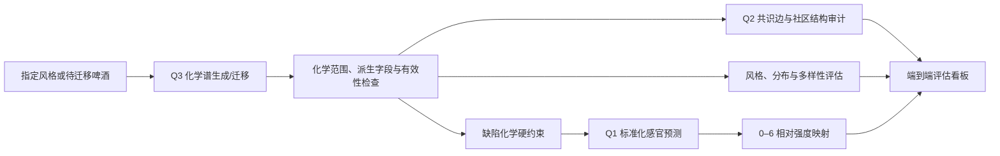

# 问题三端到端评估与优化协议

## 1. 目的与适用范围

本协议用于评估“风格条件/待迁移啤酒 -> 化学谱 -> 感官画像 -> 缺陷审计”的完整比赛流程，并用于比较问题三的生成与迁移方案。

本协议不以单一综合分数代替安全性与可信度检查。任何方案必须先通过硬门槛，才能比较风格、分布、结构、多样性和感官效果。

若本协议与正式赛题、原始附件或更新的项目约定冲突，以正式赛题、原始附件和经记录的新约定为准。

## 2. 当前固定事实

- 化学输入为 250 个样本、231 个字段和 22 种风格。
- 验证继承问题一的 7 重复×3 折风格平衡外层划分。
- Q1 主感官模型当前为 `HOLD`：13 个 A 级、11 个 B 级、6 个 C 级。
- Q1 全数据推理器可用，但只供最终拟合与候选样本推理，不得作为泛化性能证据。
- Q2 为 `READY`；问题三交接包含 21 个网络分区、710 条共识边、60 个共识模块和 46 条候选记录。
- Q2 候选物是稳定的预测/关联证据，不是因果性配方控制结论。
- 五个缺陷感官目标中只有 `X4vg` 达到 A 级；`dms`、`diacetyl`、`t2n`、`stale_hops` 为 C 级。
- `stale_hops` 只允许探索性报告，不得作为硬约束或声称“已可靠控制”。
- 0–6 映射是待固定的报告层；它不能冒充无法识别的原始人工评分逆标准化。

## 3. 端到端流程

## 4. 验证边界与防泄漏规则

1. 每个外折内只使用外层训练样本拟合缺失处理、缩放、特征转换、PCA、近邻结构、生成器、风格识别器、化学边界和 0–6 映射参数。
2. 外层验证样本只用于评估，不参与模型选择、带宽选择、停止时刻、约束调节或拒绝采样阈值选择。
3. 一切生成性能证据必须来自外层留出样本；全数据重训结果只用于最终生成和展示。
4. 生成 1000 个样本不等于获得 1000 份真实证据。置信区间和稳定性统计必须以外折、重复和真实样本为单位，不得把合成样本数当作独立样本量。
5. 问题三反复优化时，默认使用 repeat 0–2 作发现集；repeat 3–6 作锁定确认集。查看确认集后不得再调整同一方案。
6. 若确认后仍要继续优化，必须生成全新外层随机种子或把新方案降级为探索证据。

## 5. 单样本追踪记录

每个生成或迁移样本必须可追溯到以下信息：

- 运行名、配置哈希、模型种子、外层 repeat/fold、条件风格和样本标识。
- 生成/迁移前后的 231 维化学谱。
- 变化字段、标准化 L1/L2 距离、变化字段数和变化的 Q2 共识模块。
- 目标风格概率及相对原样本的改变。
- 30 个主感官目标的标准化预测、0–6 相对等级、不确定性和 A/B/C 可信度。
- DMS、Diacetyl、4VG、trans-2-nonenal 的化学约束状态。
- `X4vg` 感官审计和 `stale_hops` 探索性监控。
- 距离最近训练样本的距离、是否完全复制、是否进入近邻复制危险区。
- 硬门槛通过/失败状态及具体失败原因。

## 6. 硬门槛

硬门槛不参与加权总分，任一项失败即不能把该方案宣称为可用冠军。

| 门槛 | 最低要求 | 失败处理 |
|---|---:|---|
| 数据身份与列集 | 250 样本合同与 231 特征合同全部通过 | 终止运行 |
| 折内拟合 | 泄漏检查 100% 通过 | 整轮证据作废 |
| 数值有效性 | NaN/Inf 为 0 | 拒绝样本并修复生成器 |
| 派生字段 | 4 个汇总字段全部由组成项重算 | 不得独立优化 |
| 可行域 | 不违反折内锁定的物理/变换域 | 投影、重采样或拒绝 |
| 缺陷化学约束 | DMS/Diacetyl/4VG/trans-2-nonenal 违反率为 0 | 拒绝样本或方案 |
| 完全复制 | 精确复制训练行的比例为 0 | 方案不通过 |
| 近邻复制 | 不超过折内真实—真实基准的危险线 | 增大扰动/改变模型 |
| 端到端输出 | 化学、感官、缺陷、风格和追踪字段齐全 | 不进入正式评估 |

## 7. 真实—真实参考线

小样本生成评估不应依赖无依据的绝对阈值。对于分布、联合结构、风格概率、多样性和感官画像，每个外折应先在训练数据内建立真实—真实参考分布：

1. 按目标风格从外折训练样本中重复构造两个互斥真实子样本。
2. 子样本大小尽量与对应风格外折验证样本数一致。
3. 重复计算评估量，保留中位数、5% 和 95% 分位数。
4. 生成—真实验证集距离与该参考分布比较。

对于越小越好的距离指标，定义：

\[
R_D = \frac{D(\text{生成},\text{真实外折})}
{\operatorname{median}D(\text{真实子样本}_1,\text{真实子样本}_2)}
\]

- `R_D <= 1`：达到真实样本自身波动的中位水平，为理想状态。
- 生成—真实值不劣于真实—真实 95% 上界：通过最低线。
- 超过 95% 上界：未达标。

对于 Kriek 和 Lambic 等小样本风格，必须报告宽区间，不得因生成样本数很多而声称高精度。

## 8. 七类效果指标

### 8.1 边际分布

- 按风格、字段和外折计算归一化 Wasserstein 距离。
- 报告中位数、5%/95% 分位数偏差。
- 报告训练折最小—最大范围越界率和 1%–99% 尾部比例。
- 不允许少数高方差字段掩盖多数字段的退化；同时报告中位数、上四分位数和最差字段。

### 8.2 联合结构

- Spearman 相关矩阵差的 Frobenius 范数。
- 710 条 Q2 共识边的符号保持率、强度偏差和丢失率。
- 60 个共识模块的模块内协方差/相关误差。
- 风格内样本过少时，单风格结构只作描述；正式结构门槛以跨风格汇总和外折稳定性为主。

### 8.3 风格一致性

- 风格分类器只在外折训练集拟合和调参。
- 条件生成报告目标风格概率分布、目标风格命中率和相对真实外折的差距。
- 风格迁移报告迁移前后目标风格概率变化及跨过预声明判定线的比例。
- 分类器本身必须报告真实外折性能；若其不能可靠识别目标风格，风格概率不得作为硬证据。

### 8.4 多样性与记忆

- 生成样本唯一率和成对距离分布。
- 生成样本到最近训练样本的距离，与真实外折到训练集的距离对照。
- 精确复制率、近邻复制率和按风格的模式崩溃检查。
- 经验重采样可作分布参考，但因复制训练行不能成为可用的最终生成器。

### 8.5 感官画像

- 主评估使用 Q1 标准化预测，不用量化后的整数等级作为训练目标。
- 对 24 个 A/B 级目标报告生成—真实风格的 Wasserstein 距离、均值/分位数偏差和预测区间。
- 6 个 C 级目标只审计，不作为冠军选择的主要证据。
- 对迁移样本同时报告标准化感官变化、0–6 相对等级变化和置信区间。

### 8.6 缺陷与物理约束

- DMS、Diacetyl 和 4VG 使用已锁定的保守绝对阈值策略。
- trans-2-nonenal 因本地绝对阈值不完整，执行相对不恶化约束。
- `X4vg` 可作为经 OOF 验证的补充感官审计。
- `dms`、`diacetyl`、`t2n` 和 `stale_hops` 的感官预测只作探索报告，不得覆盖化学硬约束。

### 8.7 风格迁移代价

对 Pils/Lager -> Tripel 等迁移，每个样本报告：

- 目标风格概率提升。
- 按外折训练尺度标准化的 L1/L2 改变。
- 变化字段数、变化模块数和 Q2 候选字段覆盖。
- 四个化学缺陷硬约束的状态。
- 是否存在“风格概率上升但化学或感官合理性下降”。

迁移选型必须使用 Pareto 视图，同时考虑风格改善、修改代价、结构合理性和缺陷约束，不得只最大化风格分类器概率。

## 9. 0–6 相对等级映射与评估

### 9.1 定位

0–6 映射是展示和分级层，不是可校验的原始人工评分逆变换。所有输出必须保留原标准化预测，并将 0–6 结果标记为 `relative_reconstructed_scale`。

### 9.2 第一版候选映射

对每个感官目标，仅使用当前外折训练目标分布计算：

\[
u=\frac{\hat y-\operatorname{median}(y_{train})}
{\operatorname{IQR}(y_{train})/1.349}
\]

\[
score_{0-6}=\operatorname{clip}(3+u,0,6)
\]

整数等级由连续分数就近四舍五入得到。在固定该映射前，必须与经验 CDF 映射做敏感性对照，不允许为了单次展示效果事后改阈值。

### 9.3 映射验收

- 单调性 100%，不得改变同一目标的排序。
- 报告跨折中心和尺度参数的波动。
- 报告 0/6 截断率、等级占用率和是否大量挤在 3 分。
- 报告同一样本在重复 OOF 中的中位分、四分位区间和等级翻转率。
- A/B 目标可输出点估计和区间；C 目标必须标记“低可信”，不得作强结论。
- 由于原始 0–6 真值缺失，不得报告虚构的 0–6 RMSE/准确率。

## 10. 距离目标线的差距

对越大越好的指标：

\[
gap=\max\left(0,\frac{threshold-value}{|threshold|+\epsilon}\right)
\]

对越小越好的指标：

\[
gap=\max\left(0,\frac{value-threshold}{|threshold|+\epsilon}\right)
\]

对区间型指标，使用当前值到许可区间最近边界的归一化距离。

输出等级：

- `PASS`：达到最低线。
- `NEAR`：未达标，但相对差距小于 5%。
- `FAIL`：相对差距不低于 5%。

硬门槛单独显示，其差距不与其他指标平均。综合分数只用于已经通过所有硬门槛的方案排序，且不得掩盖任一分项退化。

## 11. 第一轮基线

第一轮固定比较：

1. 风格内经验重采样，仅作分布上界参考，不参与最终可用冠军评选。
2. 风格内加噪近邻生成。
3. 折内缩放和正则化的收缩高斯生成。
4. 折内 PCA 潜空间风格生成。

风格迁移此外必须包含两个参考：

- 原样本不修改：修改代价为零，但不应被判为成功迁移。
- 最近目标风格样本替换：可作为风格命中参考，但因复制和修改过大不得作为最终方案。

## 12. 冠军替换规则

新方案只有同时满足下列条件才能替换当前冠军：

1. 全部硬门槛通过。
2. 事先指定的失败指标在多数重复中改善；默认要求至少 5/7 次胜出。
3. 改善量不只来自单一风格、单一折或少数生成样本。
4. 已达标指标没有超出其跨重复自然波动的实质性退化。
5. 风格、分布、联合结构、多样性和感官之间若存在取舍，必须列出 Pareto 变化，不得只给总分。
6. 确认集或全新种子上复现发现阶段的改善。

## 13. 优化优先级

每轮只验证一个明确机制，顺序如下：

1. 修复数据泄漏、无效数值、派生字段不一致、化学越界和缺陷违反。
2. 消除训练样本复制和模式崩溃。
3. 改善目标风格一致性。
4. 改善边际分布。
5. 修复 Q2 共识边、社区共变和联合结构。
6. 在不牺牲分布与结构的前提下改善多样性。
7. 优化 A/B 级 Q1 感官画像。
8. 最后减少迁移的字段数、模块数和标准化修改距离。

不允许同时更换生成器、预处理、缺陷约束和后处理，然后用一个综合分数声称改进。

## 14. 每次正式运行的最小产物

每个正式运行目录至少包含：

- `config.resolved.yaml`：完整解析配置。
- `run_manifest.json`：代码版本、环境、输入 SHA256、种子和状态。
- `folds.csv`：实际使用的 repeat/fold 分配。
- `generated_samples.parquet`：生成/迁移化学谱。
- `sample_trace.parquet`：单样本端到端追踪。
- `hard_gates.csv`：逐样本与汇总硬门槛。
- `real_real_reference.csv`：折内真实—真实基准分布。
- `metrics_by_fold.csv`：逐风格、逐折、逐重复指标。
- `metrics_summary.csv`：均值、中位数、标准差、四分位距和 bootstrap 95% 区间。
- `distance_to_target.csv`：最低线、理想线、当前值、相对差距和 `PASS/NEAR/FAIL`。
- `sensory_profiles.parquet`：标准化感官、0–6 相对等级、区间与可信度。
- `decision.md`：本轮想改善的指标、必须保护的指标、结果和采用/拒绝理由。

必须支持逐折断点续跑和流式落盘。中断后只允许续跑配置和输入哈希完全一致的任务。

## 15. 结果展示

每轮优先生成以下图表：

1. 硬门槛红黄绿表。
2. 当前值、最低线、理想线和差距排序表。
3. 生成—真实与真实—真实距离对照图。
4. 风格概率分布和真实外折混淆矩阵。
5. 多样性—保真度 Pareto 图和最近训练样本距离图。
6. Q2 共识边符号保留与社区结构误差图。
7. 标准化感官及 0–6 相对等级的带区间画像图。
8. 迁移的风格改善—修改代价—缺陷约束 Pareto 图。

## 16. 阶段判定

- `BLOCKED`：数据合同、泄漏或运行器错误导致结果不可用。
- `HOLD`：结果可复现，但至少一个硬门槛或预声明的最低效果线未通过。
- `READY_WITH_LIMITATIONS`：全部硬门槛通过，主效果指标达到最低线，但小样本风格、Q1 C 级目标或 `stale_hops` 等限制仍需明示。
- `READY`：全部硬门槛和预声明的主要效果线通过，确认集复现，且不存在未披露的关键限制。

在当前数据条件下，问题三首个现实目标是 `READY_WITH_LIMITATIONS`，不应通过降低 Q1 或缺陷感官证据标准人为获得 `READY`。
